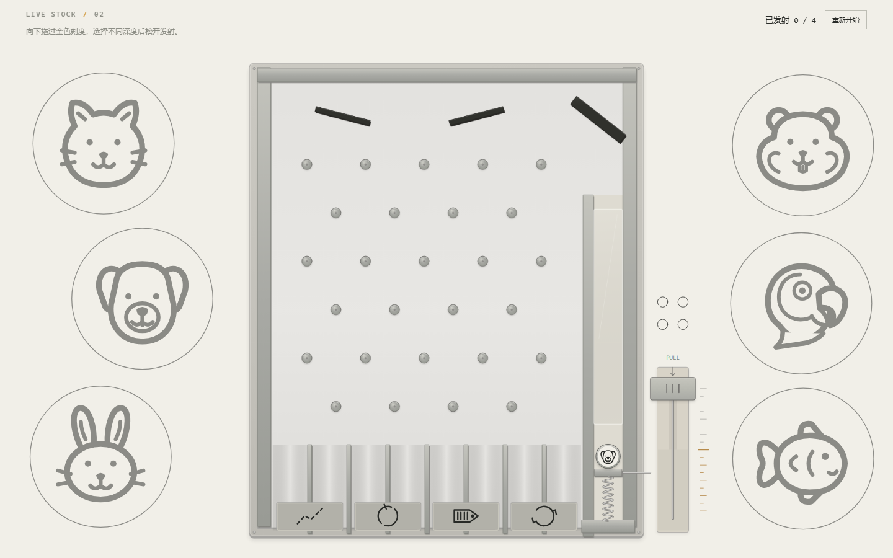
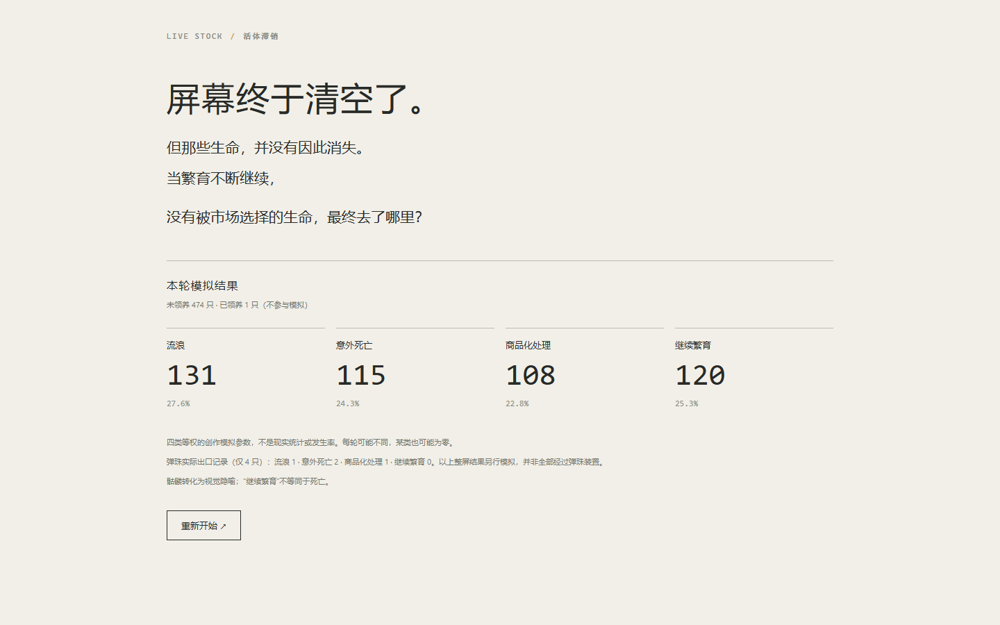

# LIVE STOCK / 活体滞销 — WIP 3 简化原型

一件关于宠物过量繁育与有限领养能力的互动网页原型。第一阶段让用户尝试通过点击领养清空屏幕；满屏后先显示承载过量说明，再进入第二阶段，用户通过机械拉杆体验四只动物的真实物理弹珠分流。



当前版本包括第一阶段、真实物理弹珠与简化结尾：动物静止、褪色、转为结局符号与骷髅、逐个消散，最后显示“本轮模拟结果”。结尾目前以基础交叉淡化为主，尚未进行最终动画精修。



## 运行

在项目根目录打开 PowerShell，运行：

```powershell
powershell -ExecutionPolicy Bypass -File .\serve.ps1
```

然后在浏览器打开 <http://localhost:8000>。停止服务器时，在终端按 `Ctrl+C`。

## 操作：第一阶段

点击 START 后，画面显示“清空屏幕”和“通过点击将小动物都领养出去”。六种动物使用 SVG 图标、Canvas 绘制；点击领养后产生向外消散的小黑点，领养计数增加。

新动物从原动物的中心向外连续分散。第一阶段现有的大小、繁殖速度、图标、避让和点击反馈保持不变。满屏判定及当前繁殖动画完成后，动物暂停，先显示：“动物数量太多了，已经超出承受能力。领养的速度，已经追不上繁育的速度。”

说明停留约 4.4 秒后自动进入弹珠装置，也可点击“进入分流装置”立即继续；“重新开始”会取消倒计时。切到后台时暂停倒计时。停留时不能继续领养，动物数量与位置保持不变。时间在 `CONFIG.capacityNoticeMs` 中调整。

## 操作：第二阶段

- 向下拖动右下角手柄：总行程为 240 个逻辑像素，越过中段（120）的暗金刻度后，到底部均可松开发射；上半段不消耗次数。拖动时显示 50%–100% 蓄力。拉杆底板改为浅灰米色，不再使用大面积黄色填充。
- 长手柄行程通过线性比例映射为最多 82 个逻辑像素的实际弹簧压缩量，避免活塞穿过底部。松开后由活塞与动物的碰撞完成发射。拖动越深，弹簧储能越多。动物离开发射槽后，仅由 Matter.js 的重力和碰撞计算运动。
- 一次只体验一只动物，上一只通过出口后才装填下一只，总共四只。右上入口始终开放，止回闸门的图形与碰撞体均已移除；原有下方分隔墙、外壳和顶部导流板保留。
- 如果动物自然回落到发射通道并在活塞上停稳，会显示“动物已返回发射通道”，可以再次拉动拉杆。重发通过弹簧活塞碰撞推动同一只动态刚体，不复制动物、不重设动物的位置或速度。右上角进度统计首次发射的不同动物，重发不增加进度，也不提前记录出口。
- 中央为竖向窄长弹珠板：六排共 27 个交错碰撞钉、两块顶部挡板，以及八条底部竖向槽道。每两条相邻槽道归入一个抽象出口，共四种出口，不显示结局文字。
- 动物必须整颗通过原有出口判定线：圆形尾缘与真实刚体上缘均越线后，才记录该槽道及所属出口，并在物理更新之后移除刚体。不提前分配出口，也不保证四个出口都有记录。
- 刚体移除后，对应出口短暂高亮约 360ms，随后完全恢复默认外观，不再保持关闭面板或激活色。高亮读取原有的单次收集事件，没有独立定时器，不生成碰撞体，不改变轨迹。重复绘制不会重复触发；同一出口再次实际收到另一只动物时，才会产生新提示。
- 两侧重复使用封面的六种扁平动物图形，本轮在上一版基础上目标再放大 12.5%（相对于最初版本累计 35%），透明度仍为 50%，缓慢轻浮。左右各三只采用稳定的横向偏移、不等间隔与不同的上下留白，不逐帧随机重排。布局先预留完整浮动范围、外圆线宽与至少 12px 图标间距，再分配剩余空间。窄屏时沿用装置上下留白，必要时限制图标尺寸；不移动或缩小中央装置来迁就背景。它们仅作背景，不参与碰撞或计数。系统开启“减少动态效果”后，背景停止浮动。
- 四只动物实际通过出口后，等待最后的短闪结束，自动进入第三阶段。第二阶段出错时“重新体验”重置物理体验；“重新开始”清除所有阶段的数据并回到第一阶段。
- 拖动时缩放窗口、失去焦点或收到取消事件会取消蓄力，不意外发射。尚未首次发射时，拉杆回到原位；返回动物的再次蓄力被取消时，活塞停在当前位置，可继续操作，避免突然复位撞飞动物。飞行越界或飞行超过 30 秒未完成会提示重试；动物返回后等待用户操作不计作飞行超时，不虚构出口结果。

正常体验地址：<http://localhost:8000>。

直接测试第二阶段：<http://localhost:8000/?stage=physics>。此开发入口使用第一阶段的 45 只初始动物作为待选样本，不代表它们已经经过满屏体验。

只预览新增过量说明：<http://localhost:8000/?stage=capacity>。同样使用 45 只初始样本，仅便于检查文案、自动进入与按钮；完整体验应从不带查询参数的首页 START 开始。

## 操作：第三阶段与结尾

四只动物均到达真实出口后，再等待约 520ms，自动释放物理世界并重现第一阶段未被领养动物的只读快照。第三阶段沿用原位置、种类和外圆，不把它们重新聚成四组，也不加入新的 Matter.js 刚体。

动画约 8 秒：静止展示 → 逐渐褪色 → 交叉淡化为结局图标 → 转为简洁骷髅 → 随机顺序逐个淡出 → 文字结算页。没有位移、重型特效或外部图片。结局符号与第二阶段共用，五张通用符号图缓存后重复绘制。切换到隐藏标签页时暂停结尾时钟。

文字页保留完整指定文案，显示四类模拟数量与百分比；四项数量之和等于快照动物数，非空样本百分比合计 100.0%。已领养动物不进入快照和模拟。结尾与动画中途都可重新开始，清除模拟、快照、物理记录与上一轮时钟。

整屏结果使用独立的 `simulatedFates`，目前四类采用等权创作参数，不是现实统计或发生率，也不由四只弹珠结果推算现实概率。四只弹珠的真实结果在文字页另行标注。某类可以为零；不会为了凑齐四类强行分配。骷髅是视觉隐喻，“继续繁育”不等同于死亡。

时间与创作权重集中在 `src/reveal.js` 的 `REVEAL_CONFIG`。通过第二阶段快捷入口测试时，结尾也只有实际保存的 45 只样本，不会为了显得满屏而虚增统计；请从正常 START 流程检查满屏重现。

## 数据与实现

- 原生 HTML、CSS、JavaScript 和 Canvas 2D，无需 npm 安装或打包。Matter.js 0.20.0 与许可证保存在 `vendor/`，运行时无需访问 CDN 或任何外部服务。
- 第一阶段未被领养动物的独立只读快照保存在内存 `stageOneSnapshot`；四只代表动物从中不重复抽取，不把整屏动物加入物理引擎。
- 只有 `physicalOutcomes` 保存本阶段实际通过的出口、槽道 `laneIndex`、动物种类、动物序号 `shot`、最后一次手柄行程 `pullDistance`、弹簧压缩量 `compression` 和通过时间。`launchCount` 与 `launches` 另存该动物的发射次数及各次蓄力记录，不将重发当作新动物。内部 `exitCounts` 的未命中项保持为零。第三阶段另行生成 `simulatedFates`；两类数据不混写。
- 快照与记录仅保留在本次网页会话内，刷新页面会清除；不保存 Cookie、账号资料或外部数据。
- 第一阶段继续使用原有 1920×1080 逻辑画布。第二阶段保留相同世界坐标，但使用独立的等比视口与对应指针逆变换；窗口变化只改变显示变换，不重建、移动或缩放 Matter.js 刚体。物理固定步长仍为 1/120 秒，每个显示帧最多补算六步。

第一阶段参数在 `src/config.js` 的 `CONFIG`；第二阶段操作参数放在 `PHYSICS_CONFIG`，板框、侧墙、槽道与判定线位置共用 `PHYSICS_LAYOUT`。第二阶段动物外圆仍为 48 个逻辑像素（原 32 的 1.5 倍），碰撞半径和图形同步。主板净宽 613，八条槽道的单槽净宽约 68.6；碰撞钉与侧墙间也保留了通过余量。

不同力度有机会进入不同出口，但不是“力度档位直接对应某个结局”；同一轮仍可能出现重复出口，且不保证出口概率均等。

## 第二阶段：响应式布局与材质

外框设计尺寸为 774×932，宽高比约 0.8305:1。`src/physics-viewport.js` 在顶部信息栏与页面边距内等比适配，优先利用可用高度，同时计入外置拉杆的完整行程。宽度不足时以完整可见为先，不独立拉伸宽高、不使用 CSS transform 放大。极窄或偏方的窗口会给六个背景图形预留小型上下行。

`src/physics-materials.js` 负责暖灰哑光金属外框、石墨挡板的边缘厚度、银色碰撞钉与弹珠边缘、发射区局部亚克力护板，以及金属手柄、连接杆、可见弹簧和出口凹槽。顶部两块挡板背后的额外矩形亚克力层已移除，金属底板与挡板本身不变。固定部件按显示精度缓存；只有显示精度变化时才重新绘制缓存，避免逐帧重复计算全部渐变和阴影。两侧动物保持原有扁平图形，琥珀色仅用于少量蓄力刻度与短暂出口反馈。

当前局部优化采用独立的 `PHYSICS_PALETTE`：暖象牙白背景 `#F1EFE8`、暖灰机身 `#C5C3BC`、银灰 `#A9AAA5`、石墨挡板 `#343530`、浅灰米色拉杆底板 `#D8D3C7`，暗琥珀金 `#B68A4A` 仅用于少量刻度、蓄力提示与释放反馈。金属高光与渐变已减弱，第一阶段配色不变。

内部左右分区已重新分配，而不是在宽发射腔中再套内轨：分隔墙从 x=1206 右移至 1259，主板净宽从 560 增至 613，整个发射区净宽从 111 缩至 58。外框仍为 774×932。右侧仅由分隔墙与外壳形成一个通道，额外内轨与两侧夹持块均不存在。

钉阵、顶部挡板与底部八条槽道/四种出口随主板宽度横向展开，真实碰撞体与图形同步。发射中心为 x=1298，活塞宽 54。单个背部活塞限位面仍位于 y=904；它通过碰撞层仅作用于活塞、不挡动物，并不是球两侧的夹持结构。弹簧、拉杆、质量、重力、发射力度和四只动物的上限不变。入口开放，返回的同一只动物可重发。出口仍由整球真实越线决定，本轮将持久反馈换成短闪，并在全部完成后接入结尾。

## 测试与限制

自动物理测试（需 Node.js；本轮使用 Node.js 24 运行）：

```powershell
node --test tests/capacity-notice.test.mjs tests/physics-stage.test.mjs tests/physics-renderer.test.mjs tests/physics-viewport.test.mjs tests/reveal.test.mjs
```

测试项目、实际浏览器检查与未验证范围见 [tests/TESTING.md](tests/TESTING.md)。浏览器运行作品本身不需要 Node.js。

当前为桌面优先的 WIP 3 简化原型，支持至少 320px 宽的窗口。窄竖屏受宽度限制，装置保留上下留白；结算页内容较长时可以纵向滚动。结尾交叉淡化仍可继续精修；目前没有音效。已在 Chrome 中模拟窄屏检查，但尚未验证实体手机触摸手感、Safari/Firefox、长期运行或其他设备的帧率。极端碰撞可能触发超时或越界提示，应重新体验，而不是将异常当作一个出口结果。

## 发给别人试玩：GitHub Pages

这是纯静态项目，发布后不依赖本机 PowerShell 服务器。`localhost:8000` 只指向访问者自己的电脑，不能作为远程试玩链接。

以下是发布指引，本轮尚未替你提交、推送或启用线上网站：

1. 在 VS Code 源代码管理中提交并推送当前项目。必须包含根目录 `index.html`、完整 `src/` 与 `vendor/`，不能只上传 HTML。发布前确认没有密码、令牌或私人资料。
2. 在 GitHub 打开对应仓库，进入 **Settings → Pages**。
3. **Source** 选择 **Deploy from a branch**，选择包含当前项目的分支（如 `main`）和 **/(root)**，点击 **Save**。
4. 等待部署成功，在 Pages 页面使用 **Visit site** 获取实际网站地址，发给别人试玩。这是试玩链接，不是代码仓库链接。
5. 用未登录窗口打开该链接，从 START 检查完整流程。后续修改仍需提交并推送到选定分支，等待网站更新。

这些步骤依据 [GitHub Pages 发布源官方说明](https://docs.github.com/en/pages/getting-started-with-github-pages/configuring-a-publishing-source-for-your-github-pages-site)。GitHub Free 使用此方式时需公开仓库；发布的网站也是公开可访问的。建议先请朋友用电脑浏览器试玩。
