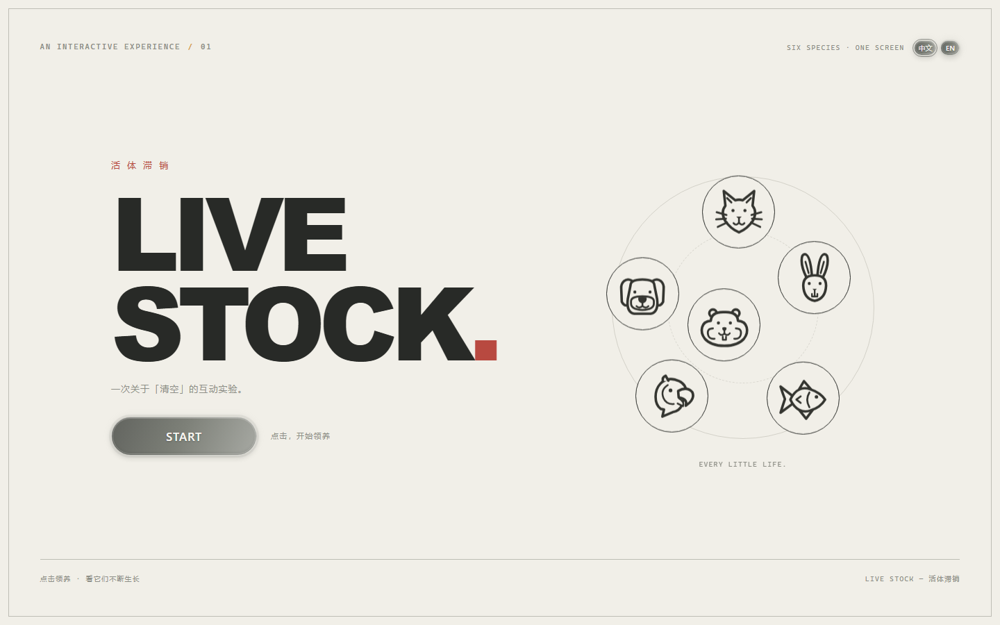
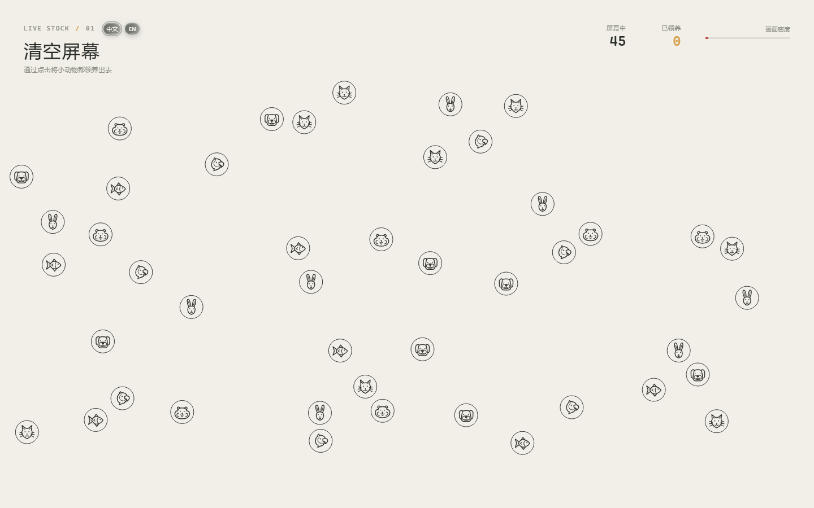
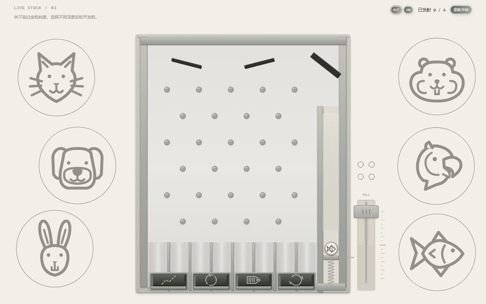
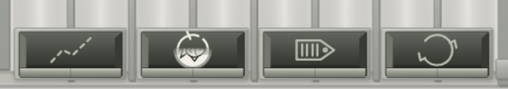
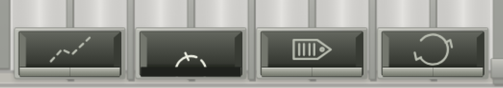

# 活体滞销 / LIVE STOCK

一件关于宠物过量繁育、有限领养能力与未被选择的生命去向的叙事性互动网页。它先请玩家完成一个简单任务——清空屏幕，再让“清空”从领养行为逐渐转变为机械分流，最后追问：离开画面的生命，后来去了哪里？

- [在线体验](https://sunlmon.github.io/publish/)（线上内容取决于最近一次 GitHub Pages 部署）
- [源代码仓库](https://github.com/Sunlmon/publish)
- [开发过程、用户试玩与 AI 使用说明](PROCESS.md)
- [素材与技术引用](CREDITS.md)

## 给谁使用

面向愿意花几分钟参与视觉互动、思考宠物繁育与消费问题的普通观众，不要求编程经验。作品以电脑鼠标操作为主，支持窗口缩放与中文 / English 切换。

## 主要互动

1. **领养与繁殖**：点击 START，然后点击猫、狗、兔子、仓鼠、鹦鹉和金鱼。图标采用经作者确认的特征强化 B 版（鹦鹉为 A 版），以耳型、脸型和完整鱼身增强辨识度，不改变圆圈尺寸。每次领养让一只动物化为黑色小点消散，并增加领养数；幸存动物不断生成同种新动物，幼崽从原动物中心连续向外移动。
2. **承载过量**：每轮开始时随机选择 **550–580 只**之间的整数作为结束点，本轮中保持不变。达到这个数量后，立即停止领养及新一轮繁殖，等待已经开始的最后一轮动画完成，再显示容量说明。密度条不提前结束；只有点击“确认”（英文 Confirm）才继续，没有自动倒计时或按钮下方提示文字。
3. **物理分流**：向下拖动右下角拉杆，越过金色刻度后松开。弹簧推动活塞，由真实碰撞发射动物。拖动深度影响力度；一共四只动物。整颗动物越过实际出口判定线后，才记录结果并以独立画面完成约 1.3 秒的“进入内腔—转为原出口符号—开盖—掉落—复位”；复位后装填下一只。动物若返回发射通道，可再次发射同一只，不多消耗动物名额。第四只完成全部处理后，装置淡出，显示“本轮分流完成 / Sorting complete”和“查看结果 / View results”按钮。淡入完成后按钮才启用，页面固定停留，不再倒计时；点击按钮才进入原结尾揭示。
4. **结尾揭示**：未被领养动物的快照停止、褪色、转成结局符号，符号完整停留 2.5 秒，再转为骷髅并逐个消散。以“看不见的滞销动物，去了哪里？”为题，用简短的中英文叙事解释购买力与繁育失衡、拉杆的命运隐喻，以及停止过度繁育的倡议。四个抽象标识仍对应文字解释，数据明确标注“本轮模拟结果”，可以重新开始；不将骷髅隐喻解释为所有动物必然死亡。













## 如何运行

这是原生 HTML、CSS、JavaScript 与 Canvas 2D 项目，**不需要 npm、构建步骤、付费账户或 API key**。唯一的第三方运行依赖是已保存在 `vendor/` 的 Matter.js 0.20.0，附完整 MIT 许可证；不需要运行时访问 CDN。请保留 `src/` 与 `vendor/`，不要只下载 `index.html`。

Windows：在项目根目录打开 PowerShell，执行：

```powershell
powershell -ExecutionPolicy Bypass -File .\serve.ps1
```

打开 <http://localhost:8000/>，按 START。保持终端运行，结束时按 `Ctrl+C`。该命令只为本次服务器进程设置执行策略，不要求永久降低系统策略。若提示脚本不存在，请确认终端位于包含 `serve.ps1` 的目录；若端口被占用，先检查是否已启动本项目服务器，不要重复启动。

其他系统：使用能将 `.js` 作为 JavaScript 提供的静态 HTTP 服务器，以本项目根目录为网站根目录。不要通过 `file://` 双击打开；浏览器需要通过 HTTP 加载 ES 模块。

可选开发入口（不代替完整流程）：

- `/?stage=physics`：直接检查弹珠互动，以 45 只初始动物保存样本。
- `/?stage=capacity`：直接检查承载过量说明，同样只使用初始样本。

## 状态、反馈与异常

- 第一阶段右上角显示屏幕数量、已领养数量与密度；领养对象即时移除，不能重复计数。
- 繁殖基础间隔约为 4.4 → 3.61 → 2.96 → 2.43 → 2.2 秒，单轮加入 ±14% 的有界变化，实际间隔不低于 2.2 秒；后期通常为 2.2–2.51 秒。幼崽位移动画仍为 1.4 秒，不叠加多轮队列。每轮数量上限仅在开始时采样一次，切换语言、领养、繁殖及重试物理不会重抽；重新开始重新采样，两轮可能偶然相同。最后不足一窝时按剩余空位生成并完整播放动画，临近上限每窝仍检查即时容量。玩家操作影响体验时长，不保证固定耗时。
- 所有页面按钮统一为高级灰渐变胶囊：主体由 `#62645F` 过渡至 `#A7A9A3`，暖白居中文字、边缘高光与克制的灰色光晕。START 约 210×56px，确认和结尾重开约 210×54px，主要按钮宽高均缩至上一版的一半；窄屏高度最低 44px。顶部工具控件进一步收紧，保留 10–11px 可读字号，语言选择以外缘细环区分。容量说明页的操作区只保留“确认 / Confirm”，不再有重新开始；装置页的重开和错误重试仍保留。没有箭头或额外图标，hover 约放大 1.02 倍、按下缩至 0.98 倍，过渡 180–220ms。开启“减少动态效果”时过渡缩短。暖白背景与其他开场元素保留，支持鼠标和原生键盘激活。
- 拉杆未过刻度、取消拖动、失去焦点或拖动时改变窗口，都不会意外消耗发射次数。上一只完成后会提示上次蓄力百分比，鼓励尝试不同力度。
- 弹珠装填位置有最多 ±3.5 个逻辑像素的初始公差，始终在真实通道内。飞行中不添加随机推力、不改出口，也不强制四类齐全。相同力度可能产生不同结果，也仍可能重复同一出口。
- 整颗球越过出口判定线后才记录一次、移除刚体，并让对应出口边缘短闪约 360ms。之后的转化、开盖和掉落不再参与物理，也不会二次记录；处理期间暂不装填下一只，盖片不增加碰撞体。四只全部处理完才冻结机器并进入完成提示，不能提前打断动画或发射第五只。
- 物理库缺失、越界或运动超时有提示和重试；异常不会被编造为出口结果。返回通道后等待用户再次操作不算飞行超时。
- 语言按钮不重置游戏；语言偏好保存在本机 `localStorage`，被禁用时仍可临时切换。没有账号、排行榜、远程数据库或分析追踪。

## 模拟数据不是现实统计

`physicalOutcomes` 只记录四只代表动物真正进入的出口。`simulatedFates` 则为整屏未领养快照独立分配创作结局，目前四类等权，**不是现实概率或调查数据，也不是从四只弹珠推算出来的比例**。已领养动物不参与模拟。某类可以为零，不强制补齐；骷髅是视觉隐喻，“继续繁育”不等同于死亡。

本作品没有采用能够覆盖这些宠物种类并持续追踪未领养个体去向的可靠数据；这里表达的是一个问题，而不是关于真实发生频率的结论。

## 实现位置

- `src/main.js`、`src/state.js`：输入、阶段切换、快照与重置。
- `src/animals.js`、`src/breeding.js`、`src/packing.js`、`src/particles.js`：六种矢量图形、繁殖、避让、领养反馈。
- `src/physics-stage.js`：Matter.js 世界、弹簧、四只动物与真实出口记录。
- `src/physics-renderer.js`、`src/physics-materials.js`、`src/physics-viewport.js`：工业装置材质、响应式视口和交互坐标映射。
- `src/outlet-processing.js`：出口视觉状态与 1.3 秒节奏；`src/physics-completion.js`：机器淡出、完成页淡入、手动查看结果与重复确认保护。均不决定真实物理出口。
- `src/reveal.js`、`src/i18n.js`、`src/styles.css`：揭示动画、双语文字与页面样式。
- `src/config.js`：动物尺寸、繁殖节奏、数量保护及物理参数。

## 测试

运行作品不需要 Node.js；开发者执行自动测试时需要 Node.js（本轮使用 24）：

```powershell
node --test tests/*.test.mjs
```

实际验证范围、复测步骤与限制见 [tests/TESTING.md](tests/TESTING.md)。真人试玩反馈和自动检查分开记录，不把脚本运行当作用户测试。

## 已知限制

- 桌面优先；窄屏可保留结构，但不保证实体手机的触摸体验。没有声音，也没有键盘替代拉杆操作。
- 有限的四球样本不应表现为“均匀抽签”；物理装置可能有偏向，相同出口重复出现不是记录错误。
- 不能根据两三位试玩者或自动物理样本推断真实用户总体体验，更不能推断现实动物去向。
- 游戏数据只存于当前会话，刷新即清除；仅语言偏好会保留。
- 跨浏览器、实体手机与长期性能仍需要进一步检查；自动时钟测试不是帧率基准。
- 参考图的原作者及原始链接未完整记录，详见 Credits。未把这些参考图片打包为网站素材。

## 提交与分享

将源代码、必要素材、README、PROCESS 与 Credits 保存在个人公开仓库，保留真实的开发提交历史。在 Canvas 提交**仓库链接**；在线试玩地址供老师与观众体验，但不能替代仓库提交。发布更新需要自行 commit、push 并等待 GitHub Pages 部署；本轮本地修改不会自动更新线上版本。
